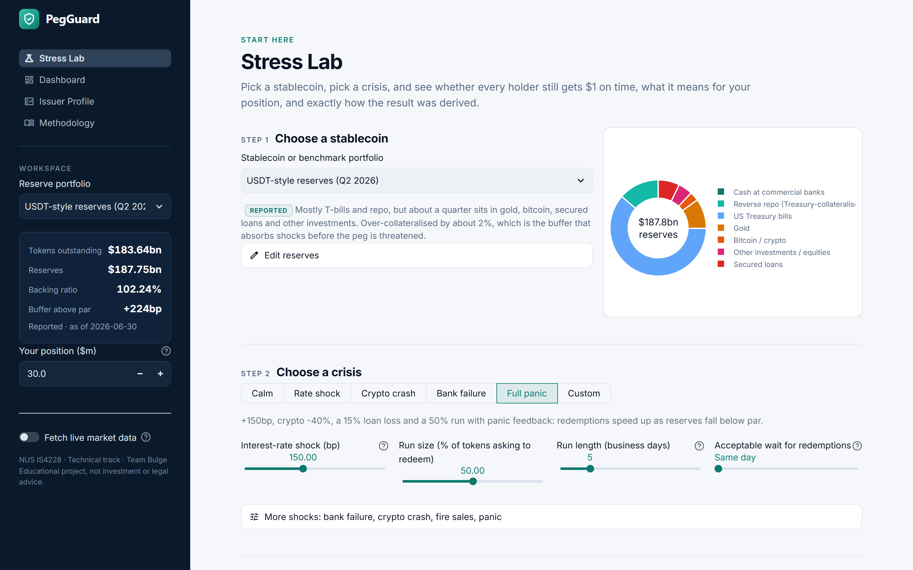

# PegGuard: Stablecoin Reserve Stress Tester

**IS4228 Information Technology and Financial Services · Technical track · Team Bulge**
**Category:** Consumer or B2B fintech application (B2B treasury risk tool)

PegGuard answers one question for a company that holds stablecoins as working capital:

> *If rates jump, a bank fails or crypto crashes, and holders rush to redeem, can this stablecoin's reserves still
> pay every token $1, on time?*

You load a fiat-backed stablecoin's reserve portfolio (real USDT and USDC compositions are bundled), apply day-0
shocks, start a multi-day redemption run, and the engine plays it out day by day: what gets sold, at what discount,
whether redemptions are paid on time, and what each remaining token is worth.



---

## Quick start

```bash
# 1. Python 3.10+ recommended
python -m venv .venv
source .venv/bin/activate            # Windows: .venv\Scripts\activate
pip install -r requirements.txt

# 2. (optional, needs internet) refresh live market data so the demo can run fully offline later
python scripts/refresh_snapshot.py

# 3. Run the app
streamlit run app.py                 # opens http://localhost:8501

# 4. Run the tests
pytest -q
```

No API keys are needed. Everything except the Live Monitor section of the Overview works with no internet connection.

### Command-line version of the core mechanic

```bash
python scripts/run_scenario.py --list
python scripts/run_scenario.py --preset svb_style --rate-shock 300 --run 20
python scripts/run_scenario.py --preset usdt_2026q2 --run 50 --days 5 --crypto-shock -50 --stress 3 --panic 0.3 --export run.csv
```

---

## What it does

| Page | What you get |
|---|---|
| **Overview** | Scorecard: every bundled portfolio under the same five standard scenarios, headline risk metrics, and a **Live Monitor** of current USD stablecoin supply and peg deviation (DefiLlama, with offline fallback). |
| **Stress Lab** (core) | Edit the reserves and set the shocks and the run. **Your scenario** tab: a verdict, a day-by-day path, loss breakdown and a plain-English narrative. **Breaking point** tab: 441 stress runs on a grid of rate shocks (0-500bp) x run sizes (0-100%) showing the exact frontier where the peg fails, plus a portfolio comparison. |
| **Reserve Quality** | Duration, rate sensitivity, a liquidity ladder (cash raisable in 1-20 days) and a simplified GENIUS Act / MAS eligibility check. |
| **Methodology** | Every formula, assumption, limitation and source. |

### The engine in one paragraph

**Day 0:** a parallel rate shock reprices bills (zero-coupon) and notes (coupon bonds) using Week 3 bond maths;
gold/crypto/equities fall by chosen %; secured loans take a credit loss; a bank failure freezes part of the bank cash.
**Days 1-N:** redemptions arrive on a front-loaded schedule and are paid at $1 through a liquidity waterfall
(cash → repo → MMF → bills → notes → gold → crypto → other → loans). Each asset can only sell a set share per day and
pays a fire-sale discount. Unpaid requests queue. Optional panic feedback (Diamond & Dybvig 1983) speeds up the run
when coverage falls below par. Output: **coverage ratio**, **value per token**, **unmet redemptions**, and a verdict:
`HOLDS`, `LIQUIDITY STRAIN`, `BELOW PAR` or `BREAKS`.

---

## Repository layout

```
pegguard/
├── app.py                     Streamlit entry point (multipage navigation)
├── app_pages/                 One file per page + shared state/styling (common.py)
├── pegguard/                  Core library, no UI code
│   ├── pricing.py             Bond pricing and rate-shock repricing
│   ├── reserves.py            Asset classes, assumptions, portfolio model
│   ├── engine.py              Day-by-day stress engine (the core mechanic)
│   ├── analysis.py            Breaking-point grid, scenario library, regulation check, risk profile
│   ├── data_sources.py        DefiLlama fetchers with cache + bundled-snapshot fallback
│   ├── presets.py             Loads data/presets.json
│   └── charts.py              Plotly figures
├── data/
│   ├── presets.json           Reserve portfolios with sources and as-of dates
│   ├── snapshots/             Offline data bundled with the repo
│   └── cache/                 Last successful live fetch (git-ignored)
├── scripts/
│   ├── run_scenario.py        CLI stress test
│   └── refresh_snapshot.py    Refresh offline data before a demo
├── tests/                     pytest suite (pricing, engine, analysis, data parsing)
└── docs/                      Build brief, demo script, Q&A prep, screenshots
```

## Deliberate scope decisions

Kept: one core mechanic that works reliably (reserve stress + run simulation), transparent assumptions, offline demo.

Left out on purpose (and why):

* **No token price / AMM model.** We value what the reserves can pay, which is what a treasury team needs. USDC's March 2023 depeg shows why market price can differ.
* **No accounts, alerts or multi-user features.** Not needed to prove the mechanic.
* **No on-chain reserve verification.** Fiat reserves are off-chain; attestations are the data source.
* **One parallel rate shock**, no yield-curve twists, no stochastic simulation: easier to explain and audit.

## Data and sources

* Circle Internet Group Form 10-Q (quarter ended 30 Jun 2026): USDC reserves and the Circle Reserve Fund.
* Tether Q2 2026 reserves report (BDO Italia attestation), via a stablecoininsider.org summary.
* CNBC, 11 Mar 2023: USDC breaks peg after Circle reveals $3.3bn SVB exposure.
* Paxos summary of the GENIUS Act (July 2025); Reed Smith summary of the MAS SCS framework (Aug 2023).
* DefiLlama stablecoin and price APIs (live data, no key).

Reserve presets are point-in-time and partly assumption-based (maturities, yields). They are clearly labelled in
`data/presets.json` and in the app. **Educational project, not investment or legal advice.**

## Publishing the repo (for the Canvas submission)

```bash
cd PegGuard
git init && git add . && git commit -m "PegGuard: stablecoin reserve stress tester"
# create an empty repo on GitHub (public, or private and invite the instructor/TA), then:
git remote add origin https://github.com/<your-account>/pegguard.git
git branch -M main && git push -u origin main
```

## Secrets

None are needed. `.env.example` is included for an optional CoinGecko key if you extend the data layer; never commit a real `.env`.
