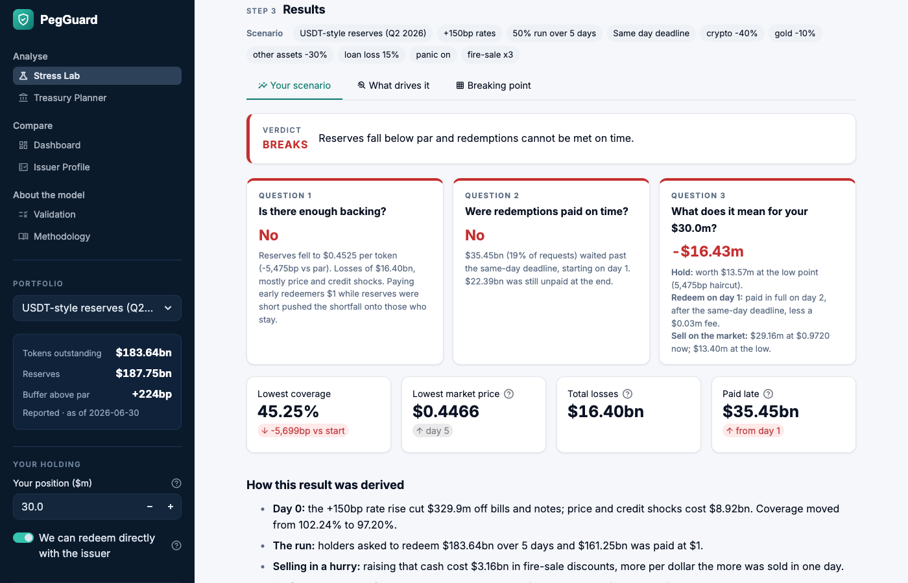

# PegGuard: Stablecoin Reserve Stress Tester

**Live app: STREAMLIT_APP_URL**

*IS4228 Information Technology and Financial Services · Technical track · Team Bulge*

PegGuard helps a company that holds stablecoins as working capital answer one question:

> If rates jump, a bank fails or crypto crashes, and holders rush to redeem, can this stablecoin still pay every
> token $1, on time? And what does that mean for the coins we hold?

Pick a stablecoin, pick a crisis, and PegGuard plays out the run day by day: what the issuer has to sell, at what
price, whether everyone is paid on time, and what your position is worth at the end.



## How to use it

Open the live app above. It runs in the browser, with nothing to install.

1. **Stress Lab.** Choose a stablecoin and a crisis, then read the verdict: is there enough backing, are
   redemptions paid on time, and what happens to your position. The tabs show which assumption matters most and
   where the peg breaks. You can download a one-page risk memo.
2. **Treasury Planner.** Enter the coins you hold and your loss limit to get a safe amount for each coin.
3. **Dashboard** and **Issuer Profile.** Compare coins side by side and check each one's reserves against
   US, Singapore, EU and Hong Kong rules.
4. **Validation** and **Methodology.** See how the model performs on real past events, and every formula and
   source behind it.

Your position and portfolio are set in the sidebar and apply to every page.

## Does it work?

We replayed four real runs using the last public reserve report before each one. The model reaches the same
outcome every time:

| Event | What happened | PegGuard |
|---|---|---|
| USDT, May 2022 | Paid everyone | Pays everyone on time |
| USDC, SVB weekend, March 2023 | Paid at par once banks reopened | Holds, with a market dip over the weekend |
| Silicon Valley Bank, March 2023 | Could not pay, closed on day 2 | Cannot pay on day 1 |
| BUSD, February 2023 | Paid everyone | Pays everyone on time |

## Run it yourself

Needs Python 3.10 or later.

```bash
pip install -r requirements.txt
streamlit run app.py
```

To run the tests: `pip install -r requirements-dev.txt`, then `pytest`.

## What's in the repo

| Folder | Contents |
|---|---|
| `app.py`, `app_pages/` | The Streamlit app, one file per page |
| `pegguard/` | The model: stress engine, bond pricing, analysis, back-tests |
| `data/` | Reserve portfolios with their sources, and offline market data |
| `tests/` | Automated tests, run on every push |
| `scripts/` | Command-line version and a data-refresh script |
| `docs/` | Project brief |

## Data

Reserve portfolios come from the issuers' published reports: Circle (30 Sep 2026) and Tether (30 Jun 2026). Live
market data comes from DefiLlama. Each portfolio in the app says where its numbers come from. The full source list
is on the Methodology page.

*Educational project. Not investment or legal advice.*
